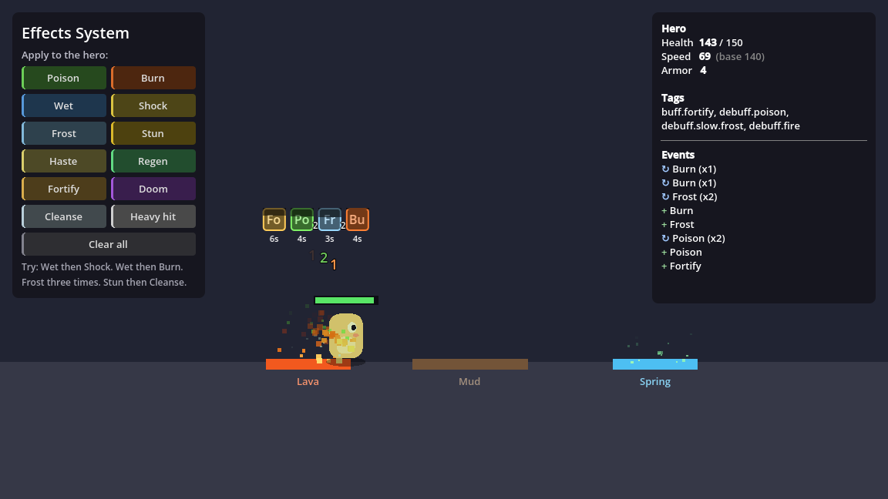

# Godot Effects System

A drop-in effects system for Godot 4 games, in pure GDScript. It covers two jobs that usually end up tangled together:

- **Gameplay effects.** Buffs, debuffs, damage and healing over time, stuns, slows, auras. They have stacking rules, tags, immunities and stat modifiers, and you build them as resources in the inspector.
- **Game feel.** Screen shake, hit-stop, hit flashes, tints, particles, floating damage numbers and sounds. Effects trigger these automatically through *cues*, and you can call them from anywhere with `Fx.shake(0.4)`.

It works in 2D, 3D and turn-based games. Godot 4.3 or later is required. It's tested on 4.3, 4.4.1 and 4.7.2.



## Contents

| Path | What it is |
| --- | --- |
| [`addons/effects_system/`](addons/effects_system/) | The system. Copy this folder into your project. |
| [`demo/`](demo/) | A playable demo: 13 example effects as `.tres` files, three zones, and a scripted effect. |
| [`tests/`](tests/) | 42 headless tests. |

## Install

1. Copy `addons/effects_system/` into your project's `addons/` folder.
2. That's it. There's no plugin to enable and no autoload to register. The classes appear in **Add Node** and **New Resource** once Godot has scanned the folder.

To try the demo first, open this folder as a project in Godot and press **F5**.

## Quick start

**1. Give an entity stats.** Add an **EffectComponent** as a child of your player, enemy or prop, and set its **Base Stats** in the inspector:

```gdscript
# Or from code:
$EffectComponent.base_stats = {&"health": 100.0, &"max_health": 100.0, &"speed": 200.0}
$EffectComponent.stat_limits = {&"health": &"max_health"}   # clamp health to 0..max_health
```

**2. Read stats instead of hard-coding them.**

```gdscript
func _physics_process(delta: float) -> void:
	if $EffectComponent.has_tag(&"control"):   # stunned, frozen, knocked down...
		return
	velocity = input_direction * $EffectComponent.get_stat(&"speed")
	move_and_slide()
```

**3. Make an effect.** In the FileSystem dock, choose **New Resource → Effect**, then fill it in. For example, a poison:

| Field | Value |
| --- | --- |
| Duration | 6 s, **Period** 1 s |
| Stack Mode | `STACK`, **Max Stacks** 5 |
| Periodic Changes | a `StatModifier`: `health`, `ADD`, `-3` |
| Tags | `debuff.poison` |
| Cues | a `TintCue` (green) and a `TextCue` with text `{amount}`, set to **Ticked** |

**4. Apply it** from a weapon, a spell, or a hitbox:

```gdscript
func _on_hitbox_body_entered(body: Node) -> void:
	var effects := EffectComponent.find_on(body)
	if effects:
		effects.apply_effect(preload("res://effects/poison.tres"), self)
```

**5. React to it.**

```gdscript
$EffectComponent.stat_depleted.connect(func(stat: StringName) -> void:
	if stat == &"health":
		die())
$EffectComponent.stat_changed.connect(func(stat: StringName, old: float, new: float) -> void:
	if stat == &"health":
		health_bar.value = new)
```

## How it works

### Stats

Every stat has a **base value**. Instant and periodic changes rewrite the base, which suits damage, healing and mana costs. **Modifiers** sit on top of the base while their effect is active, which suits buffs and slows. `get_stat()` returns the combined value:

```text
value = (base + Σ ADD) × (1 + Σ ADD_PERCENT) × Π MULTIPLY        # an OVERRIDE replaces all of it
```

Stats listed in `stat_limits` are clamped between 0 and their limit, which is another stat or a number. When max health drops, health is clamped to match. When a limited stat hits 0, `stat_depleted` fires once.

### Effects

| Setting | Options |
| --- | --- |
| **Duration Type** | `INSTANT` (applied once, never stored), `TIMED`, `PERMANENT` (until removed) |
| **Period** | Seconds between ticks of *Periodic Changes* and *Ticked* cues. Turn on **Tick On Apply** to also tick immediately. |
| **Stack Mode** | `REFRESH` resets the timer. `STACK` adds a stack up to the max and resets. `EXTEND` adds time, up to max stacks × duration. `INDEPENDENT` gives each application its own timer. `IGNORE` rejects re-applications. |
| **Stack Per Source** | Each attacker's poison gets its own stack counter. |
| **Lose One Stack On Expiry** | Stacks wear off one at a time instead of all at once. |
| **Instant Changes** | Applied to base values every time the effect lands, including re-applications. |
| **Periodic Changes** | Applied to base values every period. |
| **Modifiers** | Active while the effect lasts. |

Modifiers become active *before* the instant changes run. That means "+50 max health, heal 50" actually heals to the new maximum.

A `StatModifier` scales with the stack count by default. `ADD` scales linearly and `MULTIPLY` compounds, so a 0.7 slow at 2 stacks gives 0.49. `ADD_PERCENT` used as a change is a percentage of the stat's limit: `-0.05` health deals 5% of max health.

### Tags

Tags are hierarchical: a query for `debuff` matches `debuff.poison` and `debuff.slow.frost`.

| Field | Effect |
| --- | --- |
| `Effect.tags` | Granted to the target while the effect is active. Check them with `has_tag()`. |
| `Effect.required_tags` | The target needs all of these. *Shock* requires `wet`. |
| `Effect.blocked_by_tags` | The target must have none of these. *Burn* is blocked by `wet`. |
| `Effect.removes_tags` | Strips matching effects on landing. *Cleanse* removes `debuff`; *Wet* removes `debuff.fire`. |
| `EffectComponent.immunities` | A fire elemental with `fire` is immune to anything tagged `fire.*`. |

Rejected applications return `null` and emit `effect_rejected(effect, reason)`. The reason is `"immune"`, `"blocked"`, `"missing_tags"`, `"already_active"` or `"rejected"`.

Two stances that each have the tag `stance` and remove `stance` are mutually exclusive. Applying one swaps out the other.

### Caller values, magnitude and armor

```gdscript
# One "hit" resource for every weapon: the StatModifier's Value Key is "amount".
effects.apply_effect(hit, self, {"amount": -weapon.damage})

# "magnitude" scales every stacking modifier, for effect levels.
effects.apply_effect(poison, self, {"magnitude": 2.0})   # level 2 poison: double damage

# change_filter sees every change to a base value, for armor, shields and resistances.
effects.change_filter = func(stat: StringName, amount: float, instance: EffectInstance) -> float:
	if stat == &"health" and amount < 0.0:
		return minf(amount + effects.get_stat(&"armor"), -1.0)
	return amount
```

`instance` is `null` when the change comes from `modify_base_stat()` in your own code.

### Cues: feedback without code

Add cues to an effect's **Cues** list. Each one-shot cue has an **Events** mask: *Applied*, *Ticked*, *Reapplied* or *Removed*.

| Cue | Does |
| --- | --- |
| `TintCue` | Tints the target while active. Several tints blend. |
| `SceneCue` | Spawns a scene, usually particles. `ONE_SHOT` spawns on events. `WHILE_ACTIVE` attaches the scene and fades it out when the effect ends. |
| `FlashCue` | Flashes the target. Defaults to *Applied* and *Ticked*. |
| `TextCue` | Floating text with `{name}`, `{stacks}`, `{amount}` and `{signed}`. Damage numbers are `{amount}` on *Ticked*. |
| `ShakeCue` | Camera shake. Trauma builds up with repeated hits. |
| `HitstopCue` | A freeze frame. |
| `SoundCue` | A one-shot sound, positional or global, with pitch variation. |

### `Fx`: game feel from anywhere

Every `Fx` method is static. Pass a `Vector2` for 2D or a `Vector3` for 3D.

```gdscript
Fx.shake(0.4)                                   # active Camera2D, or else Camera3D
Fx.hitstop(0.06)                                # freezes, then restores Engine.time_scale
Fx.flash($Sprite2D, Color.WHITE, 0.12)          # 2D modulate, the flash shader, or a 3D mesh overlay
Fx.push_tint($Sprite2D, "frozen", Color.CYAN)   # stacks; Fx.pop_tint($Sprite2D, "frozen") restores
Fx.spawn(explosion_scene, global_position)      # one-shot particles free themselves
Fx.popup_text("-25", global_position, Color.RED)
Fx.play_sound(hit_sound, global_position, 0.0, 0.1)
```

Tuning settings are static variables: `Fx.shake_offset_2d`, `Fx.shake_decay`, `Fx.text_duration` and so on. A plain `modulate` flash is bright but not a pure silhouette. For a true white flash, give the sprite a `ShaderMaterial` with `addons/effects_system/fx/hit_flash.gdshader`, and `Fx.flash` animates the shader instead.

### Nodes

- **EffectZone**: add it under an `Area2D` or `Area3D`. It applies its effects to anything that enters. Set **Reapply Interval** for lava or a healing spring, or **Remove On Exit** for auras and mud.
- **EffectBar**: an `HBoxContainer` that shows a component's effects. Each slot has the effect's icon (or coloured initials), a timer sweep, the stack count and the seconds left. Hover a slot to see the description.

### Scripted effects

When the inspector isn't enough, extend `Effect`. [`demo/doom_effect.gd`](demo/doom_effect.gd) deals a big hit only if the effect runs out rather than being cleansed:

```gdscript
extends Effect

@export var damage := 40.0

func _removed(instance: EffectInstance) -> void:
	if instance.removal_reason == EffectInstance.RemovalReason.EXPIRED:
		instance.component.modify_base_stat(&"health", -damage)
```

The hooks are `_can_apply(component, params)`, `_applied`, `_ticked`, `_reapplied(instance, previous_stacks)` and `_removed`. Keep per-target state in `instance.data`, because the resource itself is shared.

Custom cues work the same way. Extend `EffectCue` and override `_fire(event, instance)` for one-shots, or `_start` and `_stop` for persistent visuals.

### Turn-based games

Set **Update Mode** to `MANUAL` and call `advance(1.0)` once per turn. Durations and periods are then counted in turns.

## API at a glance

**EffectComponent**: `apply_effect(effect, source, params)`, `remove_effect(effect_or_id)`, `remove_effects_with_tag(tag)`, `remove_effects_from(source)`, `clear_effects()`, `has_effect()`, `get_effect()`, `get_stacks()`, `get_effects()`, `has_tag()`, `get_tags()`, `get_stat()`, `get_base_stat()`, `set_base_stat()`, `modify_base_stat()`, `can_apply()`, `get_rejection_reason()`, `advance(delta)`, and the static `find_on(node)`.

Signals: `effect_applied`, `effect_reapplied`, `effect_stacks_changed`, `effect_ticked`, `effect_removed`, `effect_rejected`, `stat_changed`, `stat_depleted`, `tags_changed`.

**EffectInstance**: `effect`, `component`, `get_source()`, `get_target()`, `stacks`, `time_left`, `elapsed`, `tick_count`, `params`, `magnitude`, `data`, `last_changes`, `removal_reason` (`EXPIRED`, `REMOVED` or `CLEANSED`), `get_remaining_ratio()`, `refresh()`, `set_stacks()`, `remove()`.

Every class has doc comments, so press **F1** in the Godot editor and search for any class name.

## Run the tests

```bash
godot --headless --path . --import                                   # once: registers class names
godot --headless --path . --script res://tests/run_tests.gd          # exit code 0 = all passed
godot --headless --path . --script res://tests/run_tests.gd -- stack # only tests whose names contain "stack"
```

On Godot 4.5 and later, a test also fails if it logs an engine or script error.

## Notes and limits

- While a tint or flash is active, `Fx` owns the node's `modulate` (2D) or `material_overlay` (3D) and restores the original afterwards. Don't animate those properties yourself during an effect.
- `Fx.hitstop` changes the global `Engine.time_scale`, so tweens and physics freeze too, which is the point. Camera shake runs in real time, so it keeps moving during the freeze.
- Shake moves `Camera2D.offset` or `Camera3D.h_offset`/`v_offset` by a delta each frame, so it combines with your own camera code. For cameras inside a `SubViewport`, pass the camera: `Fx.shake(0.4, camera)`.
- There is no save/load built in. To persist effects, store each instance's `effect.resource_path`, `stacks`, `time_left` and `params`, then re-apply them when loading.
