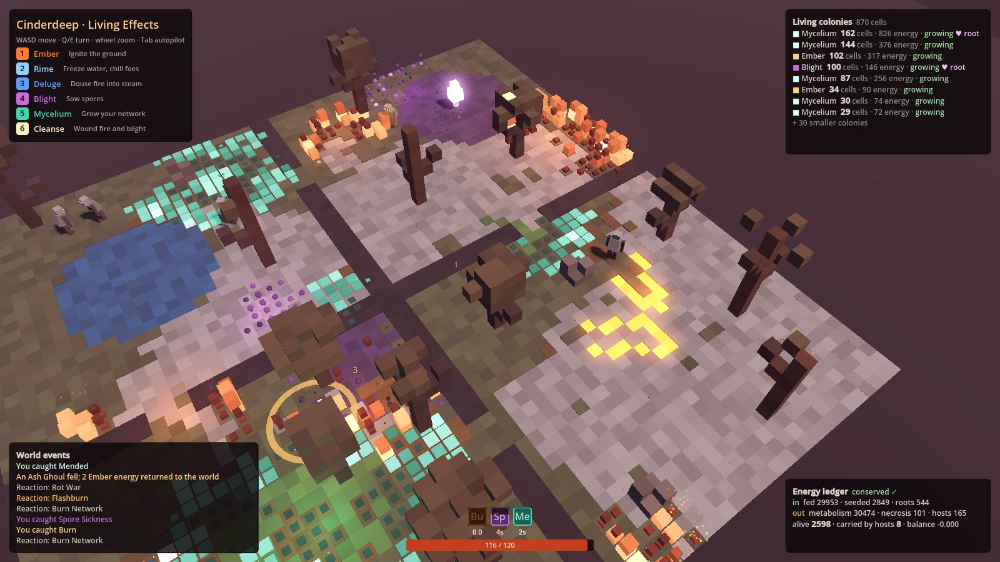

# Godot Effects System: living effects for 3D games

In most games an effect is a timer: *burning, 5 seconds, 3 damage a tick*. In this system, effects can be alive. Fire is a population of cells living in the voxels of your world. It eats dry grass and deadwood, climbs trees, leans with the wind, and leaves ash behind. Blight spreads from a heart you can hunt down. Your mycelium network grows from its node, heals whoever stands on it, fights the blight at the border, and turns ash back into living soil. Characters catch these strains as status effects, carry them, spread them as they run, and give the energy back to the world when they die.

The life cycle is your **cellular system** from Hive, applied to a game world instead of to devices: mitosis, growing, wounds, healing, necrosis, a judge, the energy rule, conservation, roots and self-repair.

It's pure GDScript for Godot 4.3 and later, tested on 4.3, 4.4.1 and 4.7.2. It also includes a complete status-effect system and 3D game-feel helpers that the living layer is built on.


## Your cellular system, applied to effects

| Hive (your devices) | Living effects (your world) |
| --- | --- |
| **Root cell**: the hub that keeps everything going | A colony's **root** (Blight Heart, Mycelium Node) generates energy and pumps it to every cell still connected to it. Kill the root and the colony is **severed**: cut-off cells live on whatever they can eat, then starve. |
| **Worker cells** | **Hosts**: characters with a `CellHost`. They catch strains, carry energy and spread it. |
| **Mitosis**: a goal splits into tasks | A cell rich enough to divide splits into a neighbouring voxel and halves its energy. Fire prefers up, water down, spores and mycelium sideways, and wind bends them. |
| **Growing** | A new cell is a seed that has to ripen before it can divide or infect anyone. |
| **Check**: Godot accepts or rejects the file | Every division is checked against the voxel it moves into: bounds, solid rock, a pond that blocks fire. Rejected divisions don't happen. |
| **Wound** | Water, cold, Cleanse or a rival strain wounds a cell. It flashes, loses energy, and heals over time if it can afford to. |
| **Necrosis**: after 3 failed heals the task dies | Too many wounds, or no energy left, and the cell dies. The voxel keeps a **scar**: grass becomes ash, wood becomes charcoal, leaves vanish, blighted ground stays blighted. The world remembers. |
| **Judge**: after each round, pick the next focus or declare it done | Every few seconds each colony is judged: *growing, stable, declining, severed, evolved* or *senescent*. A big enough Ember colony **evolves** into Wildfire. An old colony stops dividing and fades. |
| **Energy**: a device low on memory rests instead of crashing | A cell low on energy goes **dormant**, like a smouldering ember, and wakes when it's fed again. The simulation itself rests too: it has a per-frame budget, and under load the world slows down instead of the game stuttering. |
| **Conservation**: every success is its own commit; nothing is lost | Energy is never created from nothing. It enters only from food in the voxels, seeding and roots, and the ledger accounts for every unit. Tests check that the balance stays at zero through minutes of chaos. |
| **Self-repair**: work held by a quiet cell goes back to the pool | When a host dies or leaves, the energy it carried goes back into the field around it. A burning ghoul's death scatters embers. |

## What's in it

| Part | Classes | What it's for |
| --- | --- | --- |
| **Living effects** | `CellField`, `Strain`, `Substrate`, `Reaction`, `CellHost`, `CellSource`, `SubstrateVolume`, `CellColony` | Effects that live in a 3D voxel grid: they grow, fight and scar the world. |
| **Status effects** | `EffectComponent`, `Effect`, `StatModifier`, `EffectInstance`, `EffectTags`, `EffectZone`, `EffectBar` | Buffs, debuffs, stacking, tags, immunities and stat modifiers. Strains infect hosts through these. |
| **Feedback** | `TintCue`, `FlashCue`, `SceneCue`, `TextCue`, `ShakeCue`, `HitstopCue`, `SoundCue`, `Fx` | Tints, flashes, particles, damage numbers, camera shake, hit-stop, impact lights, shockwaves and voxel bursts. |

| Path | What it is |
| --- | --- |
| [`addons/effects_system/`](addons/effects_system/) | The system. Copy this folder into your project. |
| [`demo/`](demo/) | **Cinder Caldera**, a playable 3D demo in the Cinderdeep palette. Every strain, substrate, reaction and infection is a `.tres` file in [`demo/living/`](demo/living/). |
| [`tests/`](tests/) | 79 headless tests covering every life-cycle rule, energy conservation under random chaos, save and restore, and the demo itself. |

## Install

Copy `addons/effects_system/` into your project's `addons/` folder. There's no plugin to enable and no autoload to register. The classes appear in **Add Node** and **New Resource** once Godot has scanned the folder.

To try the demo, open this folder as a project in Godot and press **F5**.

## Quick start (3D)

**1. Add a `CellField`** to your level. It covers `size` voxels of `cell_size` metres, centred on the node in x and z and rising from it. The default is 48 × 16 × 48 voxels of 0.5 m. Leave **Render Cells** on to see cells as voxels. Turn on **Render Substrates** if you want the field to draw the ground too, including its scars.

**2. Describe the world.** Create `Substrate` resources such as dry grass with `{&"fuel": 14.0}` and `residues = {&"fire": ash}`, or a pond with `blocks_tags = [&"fire"]`. Paint them with **SubstrateVolume** nodes (box, sphere or cylinder), with `field.paint_box()`, or straight from your own voxel world:

```gdscript
# Cinder's voxels can describe themselves; answers are cached.
field.substrate_provider = func(cell: Vector3i) -> Substrate:
	return DRY_GRASS if my_world.is_grass(cell) else null
```

**3. Make a strain.** **New Resource → Strain**. The fields are grouped by life stage: Energy, Growth, Wounds, Hosts, Colony, Residue and Look. A minimal fire: `feeds_on = &"fuel"`, `spread_up = 2.2`, `infection_effect = burn.tres`, `light_energy = 1.4`, `particles = embers.tscn`.

**4. Let characters catch it.** Put a **CellHost** next to the character's **EffectComponent**. Its position is the character's feet.

**5. Seed it** from abilities, weapons, braziers or level scripts:

```gdscript
field.spray(EMBER, target_point, 1.0, 10.0, true, true)  # a disc of fire, only where there's fuel
field.seed(BLIGHT, heart_position, 12.0, true)         # a root: the colony's heart
field.wound_area(point, 2.5, 2, 4.0, &"fire")          # douse or cleanse
```

Or drop in a **CellSource** node, such as a lava vent seeding embers every 9 seconds or a Blight Heart planting its root.

**6. Listen to the world.**

```gdscript
field.colony_evolved.connect(func(colony, from, to): print(from.display_name, " became ", to.display_name))
field.colony_severed.connect(func(colony): print("The heart is dead"))
field.substrate_changed.connect(func(cell, substrate): world_memory[cell] = substrate)
field.host_released.connect(func(host, strain, energy): print(host, " gave back ", energy))
```

## How a cell lives

Each simulation pass (8 per second by default), every cell does this in order:

1. **Grows.** Its age rises. A seed younger than `mature_time` can't divide or infect.
2. **Feeds** on its voxel's nutrient (`feeds_on`, up to `feed_rate`). The voxel's supply runs out, so fire moves on.
3. **Pays its metabolism.** Dormant cells pay `dormant_metabolism` of it; senescent colonies pay double.
4. **Rests or wakes.** Below `rest_energy` it goes dormant; above `wake_energy` it wakes. Roots never sleep.
5. **Heals** one wound every `heal_time`, if it can afford `heal_cost`.
6. **Divides** (mitosis) once it's mature, awake, rich (`split_energy`) and its colony isn't at `max_colony_cells`. Moving into another strain runs their **Reaction** instead.

At the end of each pass:

- **Hosts** standing in mature cells are infected.
- Carriers **shed** cells as they walk.
- Roots **supply** their connected cells.
- Colonies that are due are **judged**.

Running out of energy, or reaching `max_wounds`, is **necrosis**. The cell dies and the voxel takes its residue. The voxel's own material decides first through `Substrate.residues` (wood chars, leaves vanish), then the strain's `residue`.

### Reactions

A `Reaction` names two strains, or two **tags**, so `fire` against `blight` covers Ember, Wildfire, Blight and Sporeveil. It can do three things:

- **Wound** one or both sides, so borders grind (use `chance` to slow them down).
- **Make a product.** Both cells are consumed and the product strain takes the voxel with a share of their energy. Fire plus water makes steam, frost plus water makes frost, fire plus spores makes fire.
- **Burst.** It applies an `Effect` to hosts nearby, with an impact light, a shockwave and camera shake. For example, spores catching fire explode (Flashburn).

Seeding into another strain also reacts: in the demo, casting water onto fire runs Quench and the fire turns to steam. If a reaction only wounds and the seeded strain wins, it moves into the voxel with whatever energy it has left.

### Hosts

When a host's column (`radius` × `height`) touches a mature, awake cell, the strain's `infection_effect` is applied through the host's `EffectComponent`. Its strength (`magnitude`) scales with the cell's energy, and immunities, `resistances` and `blocked_by_tags` all apply.

The cell then hands over up to `infection_cost` energy, never more than half of what it has. The host carries that energy while the infection lasts and drops a cell every `shed_interval` where it walks. When the infection ends, the carried energy is spent. When the host dies (its `death_stat` runs out) or leaves the tree, the energy returns to the voxels around it.

### The energy ledger

```gdscript
var ledger := field.get_ledger()
# In:  seeded, fed (from substrates), generated (by roots)
# Out: metabolized (living, dividing, healing, reacting, radiating), lost (left in dying cells), host_dissipated
# Moving: to_hosts, from_hosts      Totals: alive (in cells), carried (by hosts)
# balance = in - out - alive - carried, which stays at 0
```

### Saving the world

`field.get_state()` returns a snapshot containing:

- painted substrates and every scar;
- what has been eaten from each voxel;
- every cell and colony, including roots, verdicts and generations;
- the ledger.

It uses only numbers, strings and arrays, with resources stored by path, so it goes straight into `JSON.stringify` or a save file. `field.set_state(snapshot)` restores it. That makes it possible to build Cinderdeep's persistent world that "remembers your decisions".

### Performance

Measured headless on one core:

- A field with about 2,000 burning cells costs about **7.5 ms per pass** (about 3.5 µs per cell). At 8 passes per second that's about 60 ms of work per second.
- Each pass runs within `frame_budget_ms` (3 ms by default). A pass that doesn't fit finishes over the next frames.
- Rendering adds about 2 ms per pass. Each strain is one `MultiMesh` draw call, plus one for the substrates.
- `max_cells` caps the total number of cells, and `max_colony_cells` caps each colony.

## The demo: Cinder Caldera

| Key | Action |
| --- | --- |
| WASD | Move |
| 1 | **Ember**: ignite the ground at the cursor |
| 2 | **Rime**: frost that feeds on water (freezes the pond) and frostbites |
| 3 | **Deluge**: rain that turns fire into steam and soaks (soaked hosts can't burn) |
| 4 | **Blight**: sow spores that sicken whoever walks through them |
| 5 | **Mycelium**: grow your network; standing on it heals you |
| 6 | **Cleanse**: wound fire and blight in an area |
| Q / E, wheel | Turn the camera in 45° steps, zoom |
| Tab | Autopilot (it plays itself) |

Things to try:

- Light a tree and watch the fire climb.
- Wait for an Ember colony to pass 140 cells and become Wildfire.
- Burn a path into the blight, so the spores explode.
- Cleanse the Blight Heart and watch its network be severed and recede.
- Let a burning ghoul run through dry grass.
- Watch the mycelium turn ash fields back into green loam.

The HUD shows:

- every living colony, with its verdict and whether its root is alive;
- the energy ledger;
- world events;
- your health and status effects.



Over a three-minute autopilot run, without anyone tuning it live:

- Ember evolves into Wildfire at about 20 seconds, sweeps its quadrants, and burns out by about 110 seconds.
- Rime stays bounded at the pond.
- The blight grows to about 265 cells.
- The mycelium converts about 500 voxels of ash back into loam, which can burn again.
- The ledger balance reads 0.0000 at every checkpoint.

Command-line options for screenshots and tests, after `--`: `--auto`, `--seed=N`, `--zoom=metres`, `--shot=path.png --at=seconds`.

## Status effects and game feel

The living layer infects characters through a full status-effect system, which you can also use on its own.

- **`Effect`** (a resource):
  - Duration types: `INSTANT`, `TIMED` and `PERMANENT`.
  - `period` ticks.
  - Stacking: `REFRESH`, `STACK`, `EXTEND`, `INDEPENDENT` or `IGNORE`, optionally per source, with stacks that can wear off one at a time.
  - `instant_changes`, `periodic_changes` and `modifiers`.
  - Hierarchical `tags` with `required_tags`, `blocked_by_tags` and `removes_tags`.
  - `cues`.
  - Extend it in a script for custom behaviour with `_applied`, `_ticked`, `_reapplied`, `_removed` and `_can_apply`.
- **`EffectComponent`** (a node):
  - Base stats plus modifiers: `(base + Σ ADD) × (1 + Σ ADD_PERCENT) × Π MULTIPLY`, with `OVERRIDE` replacing all of it.
  - `stat_limits` (health capped at `max_health`) and `stat_depleted`.
  - `immunities`.
  - A `change_filter` for armor.
  - Caller params (`value_key`, `magnitude`).
  - `MANUAL` update mode for turn-based games.
- **Cues** play feedback on *Applied*, *Ticked*, *Reapplied* and *Removed*. In 3D, tints and flashes use a material overlay on every mesh under the character, and text cues become billboarded `Label3D`s.
- **`Fx`** (static, no autoload):
  - `shake` (moves Camera3D `h_offset`/`v_offset`, so it combines with your camera code)
  - `hitstop`, `flash`, `push_tint` / `pop_tint`, `spawn`, `popup_text`, `play_sound`
  - New for 3D: `impact_light`, `shockwave` and `voxel_burst`
- **`EffectZone`** applies effects to anything entering an `Area3D` (or `Area2D`). **`EffectBar`** shows status icons with timers and stacks.

```gdscript
func _on_hit(body: Node3D) -> void:
	var effects := EffectComponent.find_on(body)
	if effects:
		effects.apply_effect(preload("res://effects/burn.tres"), self, {"magnitude": 1.5})
		Fx.impact_light(body.global_position + Vector3.UP, Color("#ff7a2a"))
		Fx.voxel_burst(body.global_position + Vector3.UP, Color("#6a6460"))
```

Every class has doc comments. In the Godot editor, press **F1** and search for any class name.

## Run the tests

```bash
godot --headless --path . --import                                    # once: registers class names
godot --headless --path . --script res://tests/run_tests.gd           # exit code 0 = all passed
godot --headless --path . --script res://tests/run_tests.gd -- energy # only tests whose names contain "energy"
```

On Godot 4.5 and later, a test also fails if it logs an engine or script error. On 4.3, headless runs print harmless `mesh_get_surface_count` messages from the dummy renderer. The demo renders correctly there with a real renderer.

## Using it in Cinder or AoDJV

- **Coordinates.** Cinder's voxels are 32 per metre. The field doesn't need to match them: a `cell_size` of 0.25 to 0.5 m is a good grain for effects, and the `substrate_provider` maps your voxel colours or materials to substrates.
- **Player.** Add a `CellHost` and an `EffectComponent` to `game/player.gd`, and read `effects.get_stat(&"speed")` instead of the `WALK`/`RUN` constants. Strains will then slow, burn and heal the knight.
- **Your own renderer.** If you'd rather draw everything with your own voxel shader, turn off `render_cells` and `render_substrates` and drive it from `cell_born`, `cell_died` and `substrate_changed`.
- **Persistence.** Save `field.get_state()` with the world, and dungeons or biomes keep their scars between sessions.

## Notes and limits

- The field is a fixed-size grid. For a huge open world, use one field per region or chunk and move hosts between them. Each `CellHost` can point at a specific `field`.
- Cells live one per voxel. Two strains can't share a voxel; their meeting is what reactions are for.
- Everything is single-threaded GDScript. The frame budget and the cell caps keep it smooth, but tens of thousands of cells would need a C# or GDExtension port of `CellField._update_cell`.
- While a tint or flash is active, `Fx` owns a node's `modulate` (2D) or `material_overlay` (3D) and restores the original afterwards.
- The project uses the Compatibility renderer so it runs everywhere, phones included. Forward+ works too, and its glow and fog make fire look even better.
